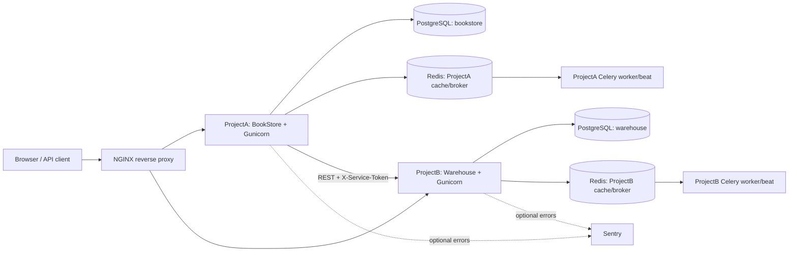

# BookStore Microservices (ProjectA + ProjectB)

The repository contains two independent Django applications that communicate over REST API.

- **ProjectA (root folder)** is the existing bookstore: books/categories, users, cart/orders, JWT/DRF API, PostgreSQL, Redis cache, Celery worker/beat, Gunicorn, NGINX, i18n and optional Sentry.
- **ProjectB (`ProjectB/`)** is a separate warehouse stock service with its own custom users, PostgreSQL database, Redis, Celery worker/beat, JWT API, stock permissions, caching, analytics and Swagger.

## Architecture



ProjectA never connects directly to ProjectB's database. It uses `GET /api/warehouse/books/<book_id>/` to retrieve stock and `POST /api/warehouse/sync/<book_id>/` to synchronize a BookStore book into the warehouse. The internal ProjectB API validates `X-Service-Token`. Requests have timeouts, response validation, HTTP error mapping and log entries.

## First-time setup

Run commands from the repository root (the existing `~/BookStore` directory):

```bash
# 1. Create secrets if these lines are not in .env yet.
grep -q '^PROJECTB_SECRET_KEY=' .env || echo "PROJECTB_SECRET_KEY=$(openssl rand -hex 32)" >> .env
grep -q '^WAREHOUSE_SERVICE_TOKEN=' .env || echo "WAREHOUSE_SERVICE_TOKEN=$(openssl rand -hex 32)" >> .env

# 2. Build and start the complete stack (ProjectB's initial migrations are included).
docker compose config
docker compose up -d --build
```

The ProjectA `.env` file must retain the existing `SECRET_KEY`, `POSTGRES_DB`, `POSTGRES_USER`, `POSTGRES_PASSWORD`, `POSTGRES_HOST`, `DATABASE_URL`, and `ALLOWED_HOSTS` values. Do not commit `.env` or production secrets.

## Addresses

- BookStore UI: `http://localhost/` (through NGINX) or `http://localhost:8000/` (direct app port for local development).
- BookStore Swagger: `http://localhost/api/docs/` or `http://localhost:8000/api/docs/`.
- ProjectB Swagger: `http://localhost/warehouse/api/docs/` (through NGINX) or `http://localhost:8001/api/docs/` (direct app port for local development).
- ProjectB API through NGINX: `http://localhost/warehouse/api/stock/` and `http://localhost/warehouse/api/report/`.
- ProjectB health endpoint: `http://localhost:8001/api/health/`.
- Django admin: `http://localhost/admin/` for ProjectA and `http://localhost:8001/admin/` for ProjectB.

## Authentication and permissions

Obtain a JWT for either API using:

```bash
curl -X POST http://localhost:8001/api/token/ \
  -H 'Content-Type: application/json' \
  -d '{"username":"YOUR_USERNAME","password":"YOUR_PASSWORD"}'
```

Send the access token in `Authorization: Bearer <access-token>`. Create an administrator independently for ProjectB:

```bash
docker compose exec projectb-web python manage.py createsuperuser
docker compose exec projectb-web python manage.py setup_warehouse
```

The `setup_warehouse` command creates the `WarehouseManagers` group with view/add/change/delete/manage stock permissions. Assign warehouse operators to the group in ProjectB admin.

ProjectA can synchronize a book (replace `BOOK_ID` with the numeric id):

```bash
curl -X POST http://localhost:8000/api/warehouse/sync/BOOK_ID/ \
  -H 'Authorization: Bearer <ADMIN_ACCESS_TOKEN>'
```

Then read that stock record with a normal authenticated ProjectA API user:

```bash
curl http://localhost:8000/api/warehouse/books/BOOK_ID/ \
  -H 'Authorization: Bearer <ACCESS_TOKEN>'
```

## Tests and OpenAPI validation

```bash
docker compose exec web pytest --cov=. --cov-report=term-missing --cov-fail-under=70 -q
docker compose exec projectb-web pytest --cov=warehouse --cov=accounts --cov-report=term-missing --cov-fail-under=70 -q
docker compose exec web python manage.py spectacular --validate
docker compose exec projectb-web python manage.py spectacular --validate
docker compose ps
```

The GitHub Actions workflow at `.github/workflows/ci.yml` builds the stack, runs the checks, tests both projects with coverage thresholds, and validates both OpenAPI schemas.

## Celery / Redis / logging / Sentry

```bash
docker compose logs -f celery celery-beat projectb-celery projectb-celery-beat
docker compose logs -f web projectb-web nginx
docker compose exec projectb-web python manage.py shell -c "from warehouse.tasks import generate_stock_report; print(generate_stock_report.delay().id)"
```

Set `SENTRY_DSN` in `.env` to enable Sentry for both Django/Celery services. Leaving it empty disables external reporting while retaining console logging.

## Production deployment note

On a VPS, install Docker Engine and the Compose plugin, clone the repository, configure strong unique `.env` secrets, and run `docker compose up -d --build`. Configure DNS/TLS at the edge (for example with a TLS-enabled reverse proxy) and permit public inbound traffic only to the proxy. The host-mapped ports `8000`, `8001`, and `5432` are development conveniences; remove those published ports or bind them to `127.0.0.1` before exposing the host to the internet. Never publish PostgreSQL/Redis directly. Set `DEBUG=False`, configure `ALLOWED_HOSTS`, `CSRF_TRUSTED_ORIGINS`, and a real Sentry DSN.
